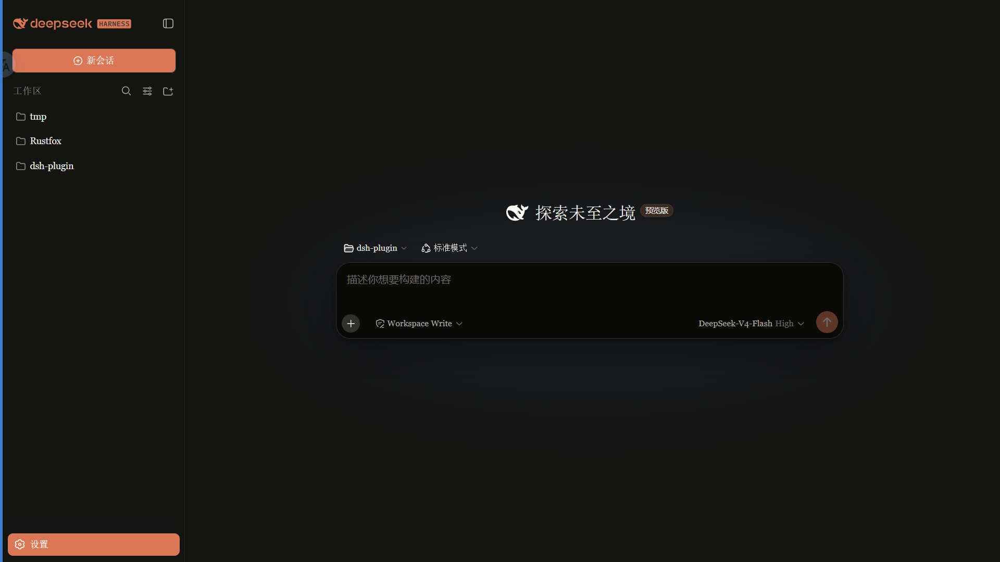
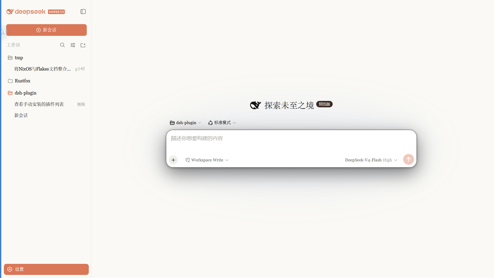

# dsh-claude-skin

> **A Claude-style skin for the DSH Web GUI**: warm-black canvas, clay accent, built-in Anthropic font modes, follows the native light/dark theme.  
> Forked from [`PAKIKNOWLEDGE/dsh-client-ui-skin-claude`](https://github.com/PAKIKNOWLEDGE/dsh-client-ui-skin-claude) (MIT)

**About this repository**: this is `xiang9916`'s personal fork. The package name and plugin identity are now `dsh-claude-skin`; the look and behaviour match upstream, serving as a base for further personal tweaks. The upstream Git history has been cleared — history starts from a single initial commit; the first release keeps upstream's version number `0.2.1`.

 · 

## Features

- Warm-black (#141413) canvas with an Anthropic clay (#d97757) accent
- Font modes:
  - **Anthropic native (default)**: Anthropic Sans for UI, Anthropic Serif for conversation, Anthropic Mono for code
  - **Skin serif**: keeps the original serif UI style
  - **System default**: leaves DSH fonts untouched
- Chinese body text falls through to **I.Ming (一點明體)** — including the new-session hero headline and its preview badge — while Latin stays Anthropic Serif: one run, two scripts
- Markdown links, file/command/skill references, file-type icons (including the plan card's MD glyph) and the "Deep diving" status render in clay
- Code blocks, inline code and menus are warmed up; syntax highlighting uses a Claude palette (clay, olive, amber, lavender)
- Slim scrollbars, clay selection/focus, pill badges
- Light and dark variants that follow the system theme

## Fonts

> **Important: the npm package does not ship font files.** Font files are available in the [`fonts/`](fonts/) folder of this repository; install them manually, then refresh/restart the web UI.

| Font | Used for | File |
|---|---|---|
| Anthropic Sans Web Text | UI | [`fonts/AnthropicSansWebText.ttf`](fonts/AnthropicSansWebText.ttf) |
| Anthropic Serif Web Text | Conversation / Markdown | [`fonts/AnthropicSerifWebText.ttf`](fonts/AnthropicSerifWebText.ttf) |
| Anthropic Mono Variable | Code / code blocks | [`fonts/AnthropicMonoVariable.ttf`](fonts/AnthropicMonoVariable.ttf) |
| I.Ming (一點明體) 8.10 | Chinese body / headings / tables / new-session hero headline & preview badge | Not bundled; fetched by [`scripts/install-iming.sh`](scripts/install-iming.sh) |

Install: on Windows double-click each `.ttf` → **Install**; on macOS import with Font Book. Refresh the page afterwards.

> The Anthropic fonts are proprietary to Anthropic and are provided for personal use only. They are **not** covered by the MIT license (see the font notice in [LICENSE](LICENSE)).

### Chinese body text: I.Ming

The conversation serif stack is ordered like this:

```css
--dsw-font-serif:
  "Anthropic Serif Web Text", Georgia, "Times New Roman",
  "I.Ming", "一點明體",          /* ← CJK lands here */
  "Noto Serif SC", "Songti SC", serif;
```

Anthropic Serif has no Han glyphs, so **Latin uses Anthropic Serif and Chinese uses I.Ming** — the browser falls back per glyph, no markup changes needed. The `skin` (serif UI) mode resolves to I.Ming as well.

Two pieces of the new-session hero would otherwise miss I.Ming: the headline inherits the UI sans stack, and the preview badge is pinned to the mono stack by the app. The skin routes both back to `--dsw-font-serif`, so they turn up in I.Ming under the anthropic and skin modes; the system font mode still leaves the native fonts untouched. Both are also set to `font-weight: 700` — I.Ming ships a Regular cut only, so the browser synthesises the bold face.

I.Ming is ~25 MB (60,017 codepoints; covers Big5, GB2312 and the Table of General Standard Chinese Characters), so it is **not committed** to this repository. The script downloads it from the official release and verifies its SHA-256:

```sh
./scripts/install-iming.sh
```

- macOS → `~/Library/Fonts/I.Ming-8.10.ttf`; Linux → `~/.local/share/fonts/` (runs `fc-cache`)
- Windows: the script prints the download URL; double-click the `.ttf` → **Install**
- Verify on macOS: `system_profiler SPFontsDataType | grep I.Ming`

> I.Ming is made by the I.Font Project and licensed under the [IPA Font License 1.0](https://github.com/ichitenfont/I.Ming/blob/master/8.10/IPA_Font_License_Agreement_v1.0.md), **not** MIT. This repository only references the family name and does not redistribute the font.

## Install

Published on npm: [`0.2.1`](https://www.npmjs.com/package/dsh-claude-skin) targets DSH 0.2.1-rc.2; the prerelease for **DSH 0.2.1-rc.3** is `0.2.1-rc.3` (dist-tag `next`). The shortest path:

```sh
dsh plugin --profile web add dsh-claude-skin         # 0.2.1
dsh plugin --profile web add dsh-claude-skin@next    # 0.2.1-rc.3, for DSH 0.2.1-rc.3
```

Installing from source or a tgz also works:

### 1. Pack to a tgz, then install

From the repository root:

```sh
npm pack
# produces dsh-claude-skin-<version>.tgz
dsh plugin --profile web add ./dsh-claude-skin-*.tgz
dsh web
```

- No global `dsh` CLI? Replace `dsh` with `npx @deepseek-ai/dsh`.

### 2. DSH Desktop

Open **Settings → Plugins** and paste the tgz absolute path into the install field.

### 3. From GitHub (available after this repository is pushed)

```sh
dsh plugin --profile web add github:xiang9916/dsh-claude-skin
```

Restart `dsh web`, then refresh the page.

> **Plugin list name and icon**: the plugin appears as **“Claude Flavour Theme”** (中文环境显示「Claude 风味主题」) with a terracotta whale icon. The title comes from `meta.title` in [`locale/en.json`](locale/en.json) / [`locale/zh.json`](locale/zh.json); the icon is declared by `"icon": "./icon.svg"` in [`package.json`](package.json).

> **Seeing no Anthropic fonts after install is expected**: the npm package does not ship font files. Import the three TTFs from [`fonts/`](fonts/) manually; for Chinese body text in I.Ming, also run `./scripts/install-iming.sh`.

## Compatibility

Verified at runtime on **DSH 0.2.1-rc.2**, and audited component by component against **DSH 0.2.1-rc.3** (client class suffixes, the `settings.general.item` slot, and the primitives / store exports are unchanged in rc.3; the only drift is the chevron icon export, renamed from `IconChevronDownOutline14` to `IconChevronDownOutlineRegular`, which this release follows). `package.json` declares the range through `engines.dsh` and `dsh.compatibility.dshReleases`, so Market / plugin lists can resolve compatibility instead of reporting unknown.

## Switching fonts

Open **Settings → General → Font style**:

- **Anthropic native (default)**: Sans UI / Serif body (I.Ming for Chinese) / Mono code
- **Skin serif**: Georgia-style serif UI, I.Ming for Chinese
- **System default**: keep DSH's default fonts

The selection applies instantly and is saved in browser localStorage.

> If you previously installed `dsh-anthropic-fonts` separately, remove it first to avoid two font overrides fighting each other.

## Switching skins

Only one skin is active at a time. This fork uses its own loader row id **`ui-claude-skin`** (upstream uses `ui-skin-claude`) and its own skin id `claude-skin`, so the two packages never collide at the loader level. They do share the `data-dsh-claude` body scope and each injects its own `<style>`, so **do not enable both** — the later one wins.

Edit `~/.dsh/cordis.patch.yml`:

```yaml
# outside the dsh-skin managed section
- insert:
    - id: ui-claude-skin
      name: 'dsh-claude-skin'
```

(and add `disabled: true` to the currently active skin's row). The config watcher hot-reloads within seconds; refresh the page.

## Uninstall

1. Remove the `ui-claude-skin` insert row from `~/.dsh/cordis.patch.yml`.
2. `dsh plugin --profile web remove dsh-claude-skin`
3. Restart `dsh web`.

## License

MIT. Upstream copyright and author credits are retained in [LICENSE](LICENSE); the Anthropic fonts remain copyright Anthropic and I.Ming is under the IPA Font License 1.0 — neither is covered by MIT.
