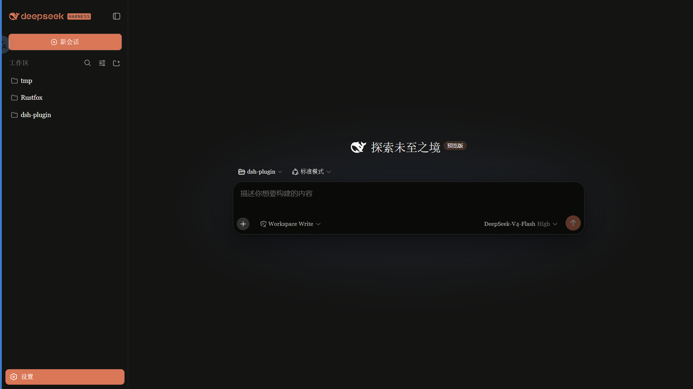
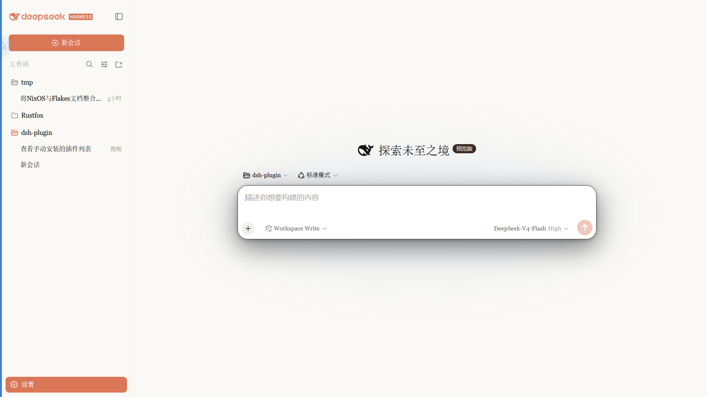

# dsh-claude-skin

> **Claude 风格的 DSH Web 界面皮肤**：暖黑画布、陶橙点缀，内置 Anthropic 字体切换，跟随原生亮/暗主题。  
> fork 自 [`PAKIKNOWLEDGE/dsh-client-ui-skin-claude`](https://github.com/PAKIKNOWLEDGE/dsh-client-ui-skin-claude)（MIT）

**关于本仓库**：这是 `xiang9916` 的个人 fork，包名与插件身份已调整为 `dsh-claude-skin`，样式与功能与上游保持一致，方便作为自己的皮肤基底继续改造。本仓库已清空上游 Git 历史，从单一初始提交开始独立演进；首个发布版本号沿用上游的 `0.2.1`。

 · 

## 特性

- 暖黑（#141413）画布 + Anthropic 陶橙（#d97757）点缀
- 字体模式：
  - **Anthropic 原生（默认）**：UI 用 Anthropic Sans，对话正文用 Anthropic Serif，代码用 Anthropic Mono
  - **皮肤衬线**：保留原来的衬线 UI 风格
  - **系统默认**：不覆盖 DSH 字体
- 字体设置位于侧栏 **插件** → **Claude 风味主题** 页面，不再占用 设置 → 常规
- 中文正文自动用到 **思源宋体 SemiBold**（含新对话空态的「探索未至之境」标题与「预览版」徽章），西文仍是 Anthropic Serif，中英混排各用其长
- 正文链接、文件 / 命令 / 技能引用、文件类型图标（含计划卡 MD 图标）与「深度求索中」状态统一为陶橙
- 代码块、行内代码、菜单等冷灰面暖色化；语法高亮使用 Claude 语法色（陶橙 / 橄榄 / 琥珀 / 薰衣草）
- 细滚动条、陶橙选中 / 焦点、胶囊徽章
- 亮 / 暗双主题，跟随系统切换

## 字体

> **重要：npm 包不随包分发字体文件。** 字体文件放在仓库 [`fonts/`](fonts/) 供下载；安装后刷新 / 重启 web 才会生效。

| 字体 | 用途 | 文件 |
|---|---|---|
| Anthropic Sans Web Text | 界面 / UI | [`fonts/AnthropicSansWebText.ttf`](fonts/AnthropicSansWebText.ttf) |
| Anthropic Serif Web Text | 对话正文 / Markdown | [`fonts/AnthropicSerifWebText.ttf`](fonts/AnthropicSerifWebText.ttf) |
| Anthropic Mono Variable | 代码 / 代码块 | [`fonts/AnthropicMonoVariable.ttf`](fonts/AnthropicMonoVariable.ttf) |
| 思源宋体 / Source Han Serif SC 2.003 | 中文正文（SemiBold）/ 标题 / 表格 / 新对话空态标题与「预览版」徽章（Bold） | 不随仓库分发，用 [`scripts/install-source-han-serif.sh`](scripts/install-source-han-serif.sh) 下载安装 |

安装：Windows 双击 `.ttf` → 「安装」；macOS 用「字体册」导入。安装后刷新页面生效。

> 字体版权归 Anthropic 所有，仅供个人使用，不适用 MIT 许可（详见 [LICENSE](LICENSE) 字体声明）。

### 中文正文：思源宋体（SemiBold 字重）

> 这一节的改动**尚未发布到 npm**：npm 上的 `0.2.1-rc.5` 仍是 I.Ming 版，想用思源宋体需要从本仓库打包安装（`npm pack` 后用 `dsh plugin --profile web add ./dsh-claude-skin-0.2.1-rc.5.tgz`）。下次随 DSH 版本一起发布时把这段提示删掉。

对话正文的衬线字族是这样排列的：

```css
--dsw-font-serif:
  "Anthropic Serif Web Text", Georgia, "Times New Roman",
  "Dsh CJK Serif",              /* ← 只接管汉字区段：SemiBold / Bold 两个切面 */
  "Source Han Serif SC", "思源宋体", "Noto Serif SC", "Songti SC", serif;
```

Anthropic Serif 不含汉字，所以**西文用 Anthropic Serif、汉字用思源宋体**，浏览器按字形逐个回退，无需拆段。`skin`（皮肤衬线）模式同样会落到思源宋体。

字重由两条 `@font-face` 控制：`Dsh CJK Serif` 用 `local()` 引用系统里已安装的思源宋体切面，并用 `unicode-range` 只覆盖汉字区段 —— 字重 < 600 走 **SemiBold** 切面，≥ 600 走 **Bold** 切面。这样正文汉字是真正的 SemiBold，标题不必再靠浏览器合成粗体，西文部分也完全不受影响；没装字体时 `local()` 失配，字族继续回退到 `Source Han Serif SC` / `思源宋体` / 系统宋体。

新对话空态的两处文字原本到不了衬线字族：「探索未至之境」大标题继承的是 UI 无衬线字族，「预览版」徽章则被应用钉在等宽字族。皮肤用一条规则把两者指回 `--dsw-font-serif`，因此 anthropic / skin 模式下它们与正文一样是思源宋体；「系统默认」模式则保持不干预字体。这两处按 `font-weight: 700` 取思源宋体的 **Bold** 切面，是真实字重而非合成加粗。

思源宋体 2.003 的简体中文七个字重约 140 MB，故**不提交进仓库**，改用脚本从官方 Release 下载并校验 SHA-256：

```sh
./scripts/install-source-han-serif.sh
```

- macOS → `~/Library/Fonts/SourceHanSerifSC-*.otf`；Linux → `~/.local/share/fonts/`（自动 `fc-cache`）
- Windows：脚本只提示下载地址，解压后全选 `.otf` → 右键「安装」即可
- 验证：macOS 里 `system_profiler SPFontsDataType | grep 思源宋体` 应能查到

> 思源宋体由 Adobe 制作，采用 [SIL 开放字体授权协议 1.1（OFL）](https://github.com/adobe-fonts/source-han-serif/blob/master/LICENSE.txt)，**不适用 MIT**；本仓库只引用字体名、不分发字体文件。

## 安装

已发布到 npm：稳定版 [`0.2.1`](https://www.npmjs.com/package/dsh-claude-skin) 对应 DSH 0.2.1-rc.2；预发布版 `0.2.1-rc.5`（dist-tag `next`）适配 **DSH 0.2.1-rc.2 / rc.3 / rc.4 / rc.5 与 0.2.2-alpha.2**，并把字体设置挪到了插件页。推荐直接安装：

```sh
dsh plugin --profile web add dsh-claude-skin         # 0.2.1（旧版字体设置位置）
dsh plugin --profile web add dsh-claude-skin@next    # 0.2.1-rc.5，适配 0.2.1-rc.5 / 0.2.2-alpha.2
```

也可以从源码 / tgz 安装：

### 1. 打包为 tgz 后安装

在仓库根目录执行：

```sh
npm pack
# 生成 dsh-claude-skin-<version>.tgz
dsh plugin --profile web add ./dsh-claude-skin-*.tgz
dsh web
```

- 未全局安装 `dsh` CLI：把 `dsh` 换成 `npx @deepseek-ai/dsh`。

### 2. DSH Desktop 桌面端

打开侧栏的 **插件** 面板，点 **添加插件**，把上面生成的 tgz 绝对路径粘贴到安装输入框即可（旧版 DSH 在 设置 → 插件）。

### 3. 从 GitHub 安装（推送本仓库后可用）

```sh
dsh plugin --profile web add github:xiang9916/dsh-claude-skin
```

装完重启 `dsh web`，刷新页面。

> **插件列表显示名与图标**：安装后在插件页的「已安装插件」里显示为 **「Claude 风味主题」**，图标是陶土橙鲸鱼。名称来自 [`locale/zh.json`](locale/zh.json) 的 `meta.title`，英文环境显示 `Claude Flavour Theme`；图标由 [`package.json`](package.json) 的 `"icon": "./icon.svg"` 指向 [`icon.svg`](icon.svg)。

> **装完看不到 Anthropic 字体是正常的**：npm 包不随包分发字体，需要手动导入 [`fonts/`](fonts/) 里的三个 TTF；想让中文正文用思源宋体 SemiBold，再执行一次 `./scripts/install-source-han-serif.sh`。

## 兼容性

| 本插件版本 | 适配的 DSH | 说明 |
| --- | --- | --- |
| `0.2.1` | 0.2.1-rc.2 | 字体设置在「设置 → 常规」 |
| `0.2.1-rc.3` | 0.2.1-rc.3 | 字体设置迁至「插件」面板 |
| `0.2.1-rc.4` | 0.2.1-rc.2 / rc.3 / rc.4 / 0.2.2-alpha.2 | 上一版 |
| `0.2.1-rc.5`（`next`） | 0.2.1-rc.2 / rc.3 / rc.4 / rc.5 / 0.2.2-alpha.2 | 当前版本 |

适配方式：逐版核对客户端插槽契约（`plugins.bundle.config` 的 keyed 注册、`view: 'page'`、按 npm 包名查 ledger）、模块表（`react`、`react/jsx-runtime`、`@deepseek-ai/dsh-client-store`、`@deepseek-ai/dsh-client-ui-primitives`）、`dsh.client.platform === 'web'` 的清单校验、`window.__ModuleLoader__.load({id, factory})` 手写包格式、`data-ds-dark-theme` / `data-slot` / `data-plugin-config` 等 DOM 锚点与皮肤用到的全部类名，以及主题 token：rc.5 的五个客户端包（theme / slots / plugin-manager / primitives / store）与 rc.4 逐字节相同，只改了版本号；rc.5 唯一的客户端契约变化是 `conversation.chat.reasoning.body` 增加 `rawText` 并让 `text` 变成处理后文本，本皮肤不注册该槽位、也不给思考区块写样式，因此无需改动。alpha.2 只删了未被使用的 `--dsw-specific-sidebar-nav-item-hover`，并新增 `--dsw-alias-illustration-*` 等插图 token（本版已改映射为暖中性色）。`package.json` 用 `engines.dsh`（宿主按 `includePrerelease` 参与比较）与 `dsh.compatibility.dshReleases` 声明兼容范围。

## 切换字体

打开侧栏 **插件** → 已安装插件 → **Claude 风味主题**，在配置区找到 **字体风格**：

- **Anthropic 原生（默认）**：Sans UI / Serif 正文（汉字思源宋体 SemiBold）/ Mono 代码
- **皮肤衬线**：Georgia 等衬线 UI，汉字同样用思源宋体 SemiBold
- **系统默认**：保持 DSH 默认字体

选择立即生效，并保存在浏览器 localStorage。设置 → 常规 不再显示这一行。

> 如果之前单独安装过 `dsh-anthropic-fonts`，建议先卸载，避免两套字体变量互相覆盖。

## 切换皮肤

同一时刻只启用一个皮肤。本 fork 使用独立的 loader 行 id **`ui-claude-skin`**（上游是 `ui-skin-claude`），`skin.json` 的皮肤 id 也改为 `claude-skin`，因此不会与上游包发生 loader id 冲突；但两个皮肤都会写入同一个 `data-dsh-claude` 作用域并各自注入一份 `<style>`，**不要同时启用**，否则后加载的会覆盖前一个的样式。

编辑 `~/.dsh/cordis.patch.yml`：

```yaml
# dsh-skin managed 段之外
- insert:
    - id: ui-claude-skin
      name: 'dsh-claude-skin'
```

（并把当前启用皮肤的 `disabled: true` 加上。）配置 watcher 几秒内热加载，刷新页面生效。

## 卸载

1. 删除 `~/.dsh/cordis.patch.yml` 里的 `ui-claude-skin` insert 行
2. `dsh plugin --profile web remove dsh-claude-skin`
3. 重启 `dsh web`

## 许可

MIT。上游版权与作者署名保留在 [LICENSE](LICENSE) 中；Anthropic 字体版权归 Anthropic，思源宋体采用 SIL 开放字体授权协议 1.1，均不适用 MIT。
